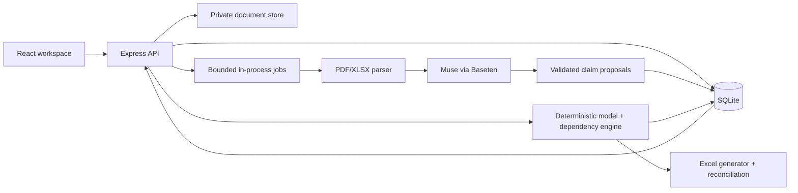

# Architecture

## Implementation record (October 29, 2026)

The approved application is now implemented as an isolated package in this directory. Its live Muse extraction and scenario interpretation have succeeded on fictional inputs. The sections below preserve the original design contract; the concrete implementation uses a compact set of modules under `src/client`, `src/server`, and `src/shared`.

SQLite schema creation lives in `src/server/db.ts` rather than numbered migrations. XLSX parsing and formula-backed OOXML export use installed `fflate` instead of ExcelJS. The client uses React local state and SVG charts instead of TanStack Query and Recharts. Node's test runner, real HTTP requests, fast-check, and Playwright replace Vitest and Supertest. These changes keep the same source-review, deterministic calculation, versioning, and export boundaries. Excel reconciliation runs through `scripts/reconcile.ps1` when desktop Excel is available.

## Environment inspection and repository decision

The current writable workspace is the existing VEIL prototype, not a Git repository. It has Node 24.15.0, npm 12, React 19, TypeScript 5.9, Vite 7, Express 5, Playwright, `node:sqlite`, and a Baseten OpenAI-compatible JSON-schema call in `server/model.ts`. SIGHTLINE has a local Baseten configuration and a documented live Muse run. No document parser, spreadsheet library or reusable financial UI exists in either inspected application. Python was not runnable from this shell. Current process has no Baseten environment variable; a network probe using the separate local configuration failed with a WebException, so live access is **unverified in this session**. No key was printed.

Use a **new isolated application** under `financial-decision-workspace/`; do not copy VEIL's storefront or policy code. Adapt its small Baseten client pattern after an endpoint probe. VEIL remains untouched. The first implementation task will initialize this directory as a standalone app and Git repository, if appropriate; these documents are the only files here now.

## Stack decisions

| Decision | Default and reason |
|---|---|
| Structure | One TypeScript package with `src/client`, `src/server`, `src/shared`; separate build targets but one deployable server. No monorepo services. |
| API | Express 5 and REST; existing local familiarity, clear upload/job endpoints and no framework migration. |
| Database | File-backed SQLite via Node 24 `node:sqlite`; transactional version publication and audit, no DB service. Migrations are numbered SQL files. PostgreSQL is a future multiuser migration. |
| Files | Original documents and derived page artifacts in a private local data directory, named by content hash; DB stores metadata. Never serve arbitrary paths. |
| PDF | `pdfjs-dist` for text/page positions and browser page rendering. Start with text PDFs; mark scan-only pages unsupported until OCR is added. |
| XLSX input/output | ExcelJS for controlled XLSX cells/formulas and formula-backed export. Treat cached formula results as stale unless independently verified. Re-evaluate if real workbooks expose unsupported features. |
| Arithmetic | `decimal.js` for prices/rates and explicit per-line rounding; persist decimal strings and currency codes. No JS binary floating-point money. |
| Validation | Zod at API and Muse boundaries; schemas shared by client and server, with additional semantic checks. |
| Charts/state | Recharts for annual cost and waterfall charts; TanStack Query for server state, local React state for unsaved edits. No global store initially. |
| Jobs | SQLite jobs table with an in-process bounded worker and restart recovery. No Redis or broker. One Muse extraction per project at a time. |
| Tests | Vitest, fast-check for selected arithmetic invariants, Supertest API tests, Playwright browser tests. |
| Deployment | Local loopback first. Later one Node service plus persistent volume; production needs authentication, tenant isolation, backup and explicit data-processing terms. |

Library choices are implementation defaults, not installed dependencies. Verify package compatibility and licenses while initializing. PDF.js is [Mozilla's PDF library](https://github.com/mozilla/pdf.js); ExcelJS [writes formula records but does not calculate them](https://github.com/exceljs/exceljs); [fast-check](https://fast-check.dev/docs/introduction/) supports property-based testing.

## Flow and boundaries

### Native Model Intelligence extension

Add a read-only inspection service over one immutable model snapshot. It joins project metadata, approved input revisions, calculated monthly/annual lines, rule identifiers, persisted dependency edges, stored scenario snapshots, source passages, and validation warnings into a bounded typed view. `GET /api/projects/:id/intelligence/inspect?modelId=` returns this view (or a paginated summary); `GET /api/projects/:id/intelligence/explain?modelId=&vendorId=&year=` returns a deterministic line-item reconciliation and evidence path. `POST /api/projects/:id/intelligence/ask` accepts `{modelId,question,context?:{kind,id,year},audience?}`. Muse may select a validated read-only intent/tool and compose candidate wording from returned evidence IDs; the server resolves IDs, totals and citations before display. `POST /api/projects/:id/intelligence/scenarios/interpret` can reuse the existing typed scenario interpreter; execution still uses the current scenario endpoint after user review.

Tool registry: `inspect_model`, `get_result`, `trace_dependencies`, `compare_vendors`, `detect_anomalies`, `preview_scenario`, and `get_source`. Each has bounded IDs scoped to the requested project/model. No SQL, arbitrary URL, private file path, approval, or mutation tool is model-visible. The model receives a small structured result selected by a query planner, never an entire workbook dump. Server-generated answer blocks carry evidence IDs and arithmetic values; Muse prose is rejected or abstained when citations or numeric facts cannot be verified. The UI renders link targets only after resolving them within the same project/version.

### Imported workbook research track

This is a separate future capability. Parse OOXML workbook/sheet relationships, shared and inline strings, styles/date systems, defined names and scoped named ranges, table references, formula tokens/AST, cross-sheet references, and calculation chain if present. Build a cell-level dependency graph, detect cycles and volatile/dynamic functions, and compare formula-derived values against independently recalculated results. External links, macros/VBA, data connections, add-ins, unsupported functions, dynamic arrays, and stale/missing caches enter an explicit unsupported or unverified state. Formula text or cached `<v>` alone cannot establish that an arbitrary workbook is understood or recalculated. Acceptance requires a supported-function matrix, tested reference resolution, independent recalculation, and abstention fixtures before any imported-model Q&A is enabled.

The [SpreadsheetML formula documentation](https://learn.microsoft.com/en-us/office/open-xml/spreadsheet/working-with-formulas) confirms that `<f>` stores formula text while `<v>` can contain a last-calculated cached value. The [calculation-chain documentation](https://learn.microsoft.com/en-us/office/open-xml/spreadsheet/working-with-the-calculation-chain) explicitly says the chain is calculation order, **not** the formula dependency tree; dependencies must be parsed from formulas and references. [ECMA-376](https://ecma-international.org/publications-and-standards/standards/ecma-376/) defines the package and markup contracts. These are research inputs, not evidence that the current proposal-XLSX parser supports imported model reasoning.



Upload is validated for extension, MIME signature, size, page/sheet count and path safety before parsing. Document text is untrusted input to Muse. Muse cannot write approved assumptions or results directly; only validated proposals are stored. Approval runs in a DB transaction that creates an assumption revision and model version, computes results, writes dependency edges and an audit event, then commits together. Failed calculations roll back the publication. Jobs are idempotent by document-version ID and stage. Per-project model publication is serialized.

## Module contract and proposed tree

```text
financial-decision-workspace/
  docs/...
  src/client/{app,pages,components,features,styles}/
  src/server/{api,db,documents,ai,review,finance,decision,export,jobs}/
  src/shared/{schemas,contracts}/
  tests/{fixtures,api,e2e}/
  migrations/
  data/                         # ignored, originals and SQLite
```

`documents` owns parsing and source spans; `ai` owns provider calls and schema parsing; `review` owns state transitions; `finance` accepts only approved typed inputs and emits an immutable model; `decision` owns comparability/switching logic; `export` uses the same approved input snapshot and reconciles; `api` owns auth/local access and input validation. Never let UI or Muse call financial persistence methods directly.

## Main API shape

`POST /api/projects`, `GET /api/projects/:id`, `POST /api/projects/:id/documents` (multipart), `GET /api/jobs/:id`, `GET /api/projects/:id/claims`, `POST /api/claims/:id/review`, `GET /api/projects/:id/model?version=`, `POST /api/projects/:id/scenarios`, `POST /api/projects/:id/scenarios/interpret`, `POST /api/projects/:id/revisions/:id/analyze`, `GET /api/projects/:id/decisions`, `POST /api/projects/:id/exports`, `GET /api/exports/:id`. Mutations carry an expected version; stale review attempts return conflict. Errors use stable codes and do not include raw document text or credentials.

Security boundary: the initial loopback app is single-user. It is not safe for public deployment without authentication, authorization and privacy review. Documents and API secrets stay server-side. Use upload limits, prompt-injection fixtures, bounded model output and data-retention controls.
